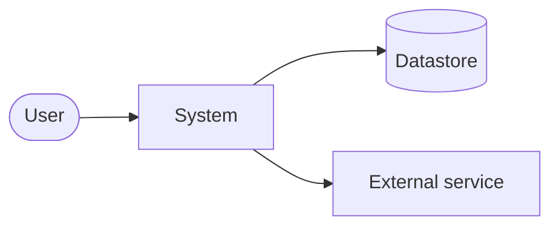

# Architecture

> **Status:** Draft <!-- Draft | Approved --> · **Last updated:** YYYY-MM-DD · **Owner:** TODO

<!--
Describe the system as it is now, plus any approved near-term changes. Record *why* in ADRs (docs/decisions/).
Write UNKNOWN rather than guessing. Delete sections that genuinely do not apply.
-->

## Overview
TODO: what the system does, and its main architectural style (for example a modular monolith, a static site plus API, a CLI, or a library).

## System context
<!-- Replace this example with the real diagram: users, the system, and external systems. -->

## Quality attributes
| Attribute | Target | How verified |
|-----------|--------|--------------|
| TODO (for example performance, availability, security) | TODO | TODO |

## Components and responsibilities
| Component | Responsibility | Location in repo | Depends on |
|-----------|----------------|------------------|------------|
| TODO | TODO | TODO | TODO |

## Data flow and storage
TODO: main data flows, data stores, data ownership, and schema or migration approach.

## Trust boundaries
TODO: where untrusted input enters, and where privileges change. Detailed threats go in `docs/security.md`.

## External integrations
| Integration | Purpose | Protocol / auth | Failure handling |
|-------------|---------|-----------------|------------------|
| TODO | TODO | TODO | TODO |

## Deployment and environments
| Environment | Purpose | Hosting / location | Deploy method |
|-------------|---------|--------------------|---------------|
| Local | Development | Developer machine | TODO |

## Observability
TODO: logging, metrics, tracing, alerting, and where to find them.

## Architecture decisions
| ADR | Title | Status |
|-----|-------|--------|
| [000](decisions/000-template.md) | Template (copy for new decisions) | — |

## Risks and technical debt
| Item | Impact | Mitigation / plan |
|------|--------|-------------------|
| TODO | TODO | TODO |
